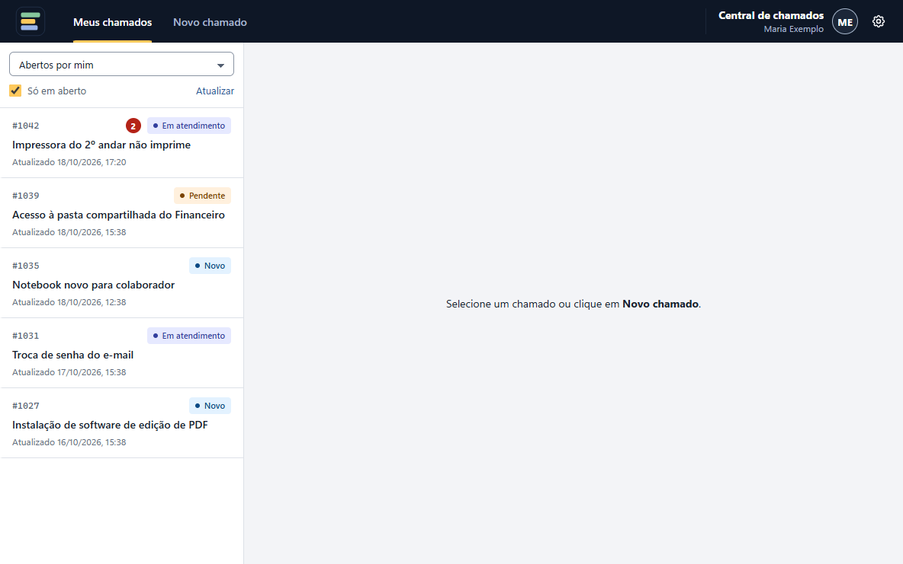
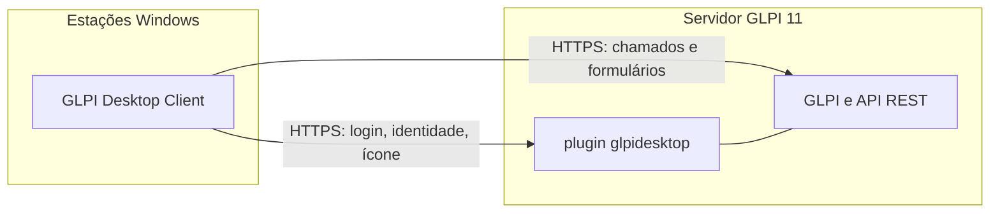

# GLPI Desktop Client

Central de chamados do GLPI na bandeja do Windows, para qualquer organização que use o GLPI 11.



## O que faz

- Mostra os chamados do usuário com as mesmas permissões do perfil dele no GLPI, com visões prontas
  (abertos por mim, observando, atribuídos, sem técnico, atrasados…) e filtros salvos nas pesquisas
  do GLPI.
- Abre chamados pelos formulários do próprio GLPI, com rascunho automático e captura de tela nos anexos.
- Avisa com notificações do Windows quando um chamado muda, com o número de novidades no ícone.
- Entra sozinho com a conta do Windows (opcional, com Active Directory) ou com usuário e senha.
- Tem tema claro e escuro e usa as cores do GLPI.
- Usa o nome, a logo, o ícone e o texto de suporte que o administrador definir no plugin.
- Conecta a qualquer servidor GLPI: o administrador define na instalação, ou o usuário informa na primeira abertura.

## Como funciona



O plugin `glpidesktop` é **obrigatório**: é por ele que o app descobre como entrar (conta do Windows ou
senha), recebe a configuração do administrador e abre a sessão do usuário na API do GLPI.

## Downloads

Página de **[Releases](https://github.com/Wantuilxavier/Glpi-desktop-releases/releases)**:

| Arquivo | O que é |
|---|---|
| `glpidesktop-x.y.z.tar.bz2` | o plugin (a pasta raiz do pacote é `glpidesktop`, padrão do GLPI) |
| `GLPI-Desktop-Client-Setup-x.y.z.exe` | o instalador das estações |
| `SHA256SUMS.txt` | o SHA-256 dos dois arquivos |

Conferir o arquivo baixado:

```powershell
# Windows: compare o resultado com a linha do arquivo em SHA256SUMS.txt
Get-FileHash .\GLPI-Desktop-Client-Setup-0.9.0.exe -Algorithm SHA256
```

```bash
# Linux, na pasta com os arquivos e o SHA256SUMS.txt
sha256sum -c SHA256SUMS.txt --ignore-missing
```

## Compatibilidade

| Plugin | App | GLPI | PHP |
|---|---|---|---|
| 0.14.0 | 0.9.0 | 11.0.x | 8.2 ou mais novo |
| 0.13.0 | 0.8.0 | 11.0.x | 8.2 ou mais novo |
| 0.12.0 | 0.7.1 | 11.0.x | 8.2 ou mais novo |
| 0.11.0 | 0.7.0 | 11.0.x | 8.2 ou mais novo |
| 0.10.0 | 0.6.0 | 11.0.x | 8.2 ou mais novo |
| 0.9.0 | 0.5.0 | 11.0.x | 8.2 ou mais novo |
| 0.8.0 | 0.4.0 | 11.0.x | 8.2 ou mais novo |
| 0.7.0 | 0.3.0, 0.3.1, 0.3.2 | 11.0.x | 8.2 ou mais novo |
| 0.6.0 | 0.2.0 | 11.0.x | 8.2 ou mais novo |
| 0.5.0 | 0.1.0 | 11.0.x | 8.2 ou mais novo |

App e plugin vêm juntos em cada release: use os dois da mesma release.

## Início rápido

1. [Instalar o plugin](docs/instalacao-plugin.md) no servidor GLPI.
2. [Configurar o plugin](docs/configuracao-plugin.md): cliente de API, autenticação, identidade e ícone.
3. [Instalar o app](docs/instalacao-estacoes.md) nas estações, manualmente ou em massa.
4. [Primeiro acesso](docs/primeiro-acesso.md) do usuário.

## Instalar o plugin no servidor

No servidor do GLPI 11, como root. Ajuste `GLPI` para a pasta do seu GLPI e `www-data` para o usuário
do servidor web (no Debian/Ubuntu é `www-data`; no RHEL e derivados, `apache` ou `nginx`).

```bash
VERSAO=0.14.0
GLPI=/var/www/glpi
BASE=https://github.com/Wantuilxavier/Glpi-desktop-releases/releases/download/v0.9.0

cd /tmp
curl -fLO "$BASE/glpidesktop-$VERSAO.tar.bz2"
curl -fLO "$BASE/SHA256SUMS.txt"
sha256sum -c SHA256SUMS.txt --ignore-missing      # deve mostrar "glpidesktop-0.14.0.tar.bz2: OK" (ou "SUCESSO")

tar -xjf "glpidesktop-$VERSAO.tar.bz2" -C "$GLPI/plugins/"
chown -R www-data:www-data "$GLPI/plugins/glpidesktop"

cd "$GLPI"
su -s /bin/sh www-data -c 'php bin/console plugin:install --username=<login-de-um-administrador-do-glpi> glpidesktop'
su -s /bin/sh www-data -c 'php bin/console plugin:activate glpidesktop'
```

Também dá para instalar pela tela: depois de extrair a pasta, **Configurar → Plugins → GLPI Desktop Client →
Instalar** e **Ativar**.

Depois, ative a API REST do GLPI e escolha o cliente de API na configuração do plugin (passo a passo em
[Instalação do plugin](docs/instalacao-plugin.md) e [Configuração do plugin](docs/configuracao-plugin.md)).
Para **atualizar**, troque a pasta, recarregue o PHP (ex.: `systemctl reload php8.2-fpm`) e rode
`plugin:install --force`, `plugin:activate` e `cache:clear`.

## Instalar o app no Windows

Os comandos rodam como **administrador** (o app é instalado para todos os usuários da máquina).
Troque `glpi.exemplo.com.br` pelo endereço do seu GLPI.

**Baixar, conferir e instalar** (PowerShell como administrador):

```powershell
$versao = "0.9.0"
$base   = "https://github.com/Wantuilxavier/Glpi-desktop-releases/releases/download/v$versao"
$exe    = "GLPI-Desktop-Client-Setup-$versao.exe"
Invoke-WebRequest "$base/$exe" -OutFile "$env:TEMP\$exe"
Invoke-WebRequest "$base/SHA256SUMS.txt" -OutFile "$env:TEMP\SHA256SUMS.txt"
$esperado = ((Get-Content "$env:TEMP\SHA256SUMS.txt" | Select-String $exe) -split '\s+')[0]
if ((Get-FileHash "$env:TEMP\$exe" -Algorithm SHA256).Hash -ne $esperado.ToUpper()) { throw "SHA-256 não confere" }
Start-Process "$env:TEMP\$exe" -ArgumentList '/S /GLPI_URL=https://glpi.exemplo.com.br' -Wait
```

**Só o instalador** (cmd como administrador, com o arquivo já baixado):

```bat
:: instalação silenciosa, já apontando para o seu GLPI
GLPI-Desktop-Client-Setup-0.9.0.exe /S /GLPI_URL=https://glpi.exemplo.com.br

:: o mesmo, sem deixar o usuário trocar de servidor
GLPI-Desktop-Client-Setup-0.9.0.exe /S /GLPI_URL=https://glpi.exemplo.com.br /LOCK_SERVER=1

:: sem /GLPI_URL, o usuário informa o endereço na primeira abertura
GLPI-Desktop-Client-Setup-0.9.0.exe /S

:: a partir da 0.2.0: com o nome que os usuários veem (janela, cabeçalho, bandeja e atalho do Menu Iniciar)
GLPI-Desktop-Client-Setup-0.9.0.exe /S /GLPI_URL=https://glpi.exemplo.com.br /APP_NAME="Central de Atendimento"
```

O nome (`/APP_NAME`) tem de 2 a 40 caracteres, sem `\ / : * ? " < > |`, e vence o nome configurado no
plugin. Detalhes, ordem de prioridade e efeito nos atalhos fixados em
[Instalação nas estações](docs/instalacao-estacoes.md#nome-do-aplicativo).

**Atualizar:** rode o instalador da versão nova da mesma forma (feche o app antes:
`taskkill /im "GLPI Desktop Client.exe" /f`). A configuração é mantida.

**Desinstalar:**

```bat
"C:\Program Files\GLPI Desktop Client\Uninstall GLPI Desktop Client.exe" /S
```

Instalação por GPO, Intune ou script, os parâmetros opcionais `/APP_TOKEN=` e `/APP_NAME=` e o arquivo
`config.json` estão em [Instalação nas estações](docs/instalacao-estacoes.md).

## Mais informações

- [Solução de problemas](docs/solucao-de-problemas.md)
- [CHANGELOG.md](CHANGELOG.md) — histórico de versões
- [SECURITY.md](SECURITY.md) — como relatar uma vulnerabilidade
- Licença: ainda não definida.
