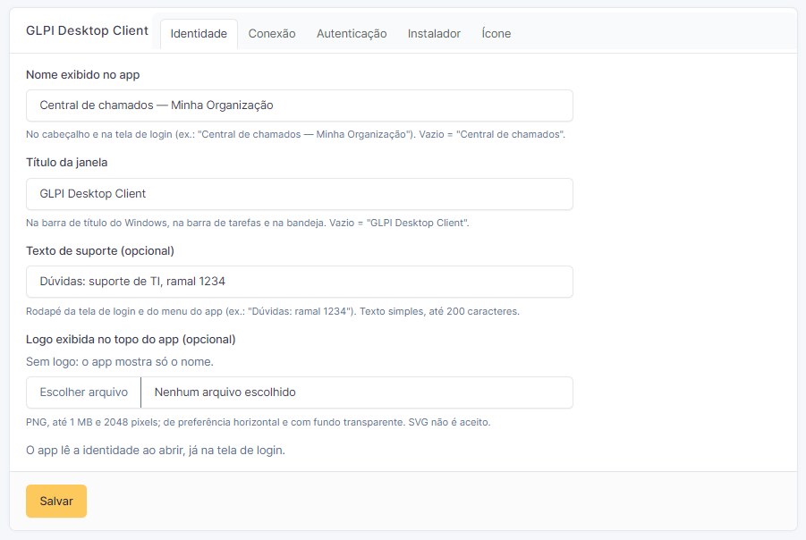

# Configuração do plugin

**Configurar → Plugins → GLPI Desktop Client** (o nome do plugin é um link). Só abre para quem pode
alterar a configuração geral do GLPI (direito *Configuração → Atualizar*, como o perfil Super-Admin).

O app respeita os **perfis do GLPI**: cada usuário vê no app os chamados que o perfil dele permite ver
no GLPI, e só pode alterar o que o perfil permite. O plugin não cria perfis nem direitos.

## Identidade

| Opção | Padrão | No app |
|---|---|---|
| Nome exibido no app | "Central de chamados" | cabeçalho e tela de login |
| Título da janela | "GLPI Desktop Client" | barra de título do Windows, barra de tarefas e bandeja |
| Texto de suporte | vazio | rodapé da tela de login e do menu da engrenagem (ex.: "Dúvidas: ramal 1234"); texto simples, até 200 caracteres |
| Logo | sem logo | topo da tela de login e cabeçalho; PNG até 1 MB e 2048 pixels (SVG não é aceito) |

O app lê a identidade ao abrir, já na tela de login, e guarda a última para abrir certo mesmo sem rede.

## Conexão

| Opção | O que é |
|---|---|
| Endereço do GLPI e da API | entram nos comandos prontos da aba Instalador |
| **Cliente de API** | o cliente de API do GLPI (*Configurar → Geral → API*) que o app usa. **Obrigatório**, a não ser que todas as estações tenham o App-Token na configuração. O app recebe o App-Token dele depois que o usuário entra; a página nunca mostra o token |
| Domínios do SSO | servidores que podem receber o login do Windows, separados por vírgula (ex.: `*.exemplo.com.br`). Vazio = só o endereço do GLPI, o que basta na maioria dos casos |
| Intervalo de verificação | de quanto em quanto tempo o app procura novidades nos chamados (1 a 60 minutos) |

Crie o cliente de API só para o app (ex.: "glpi-desktop") e preencha a **faixa de IP** das redes das
estações: o App-Token sozinho não dá acesso a nada (a API ainda exige a chave do usuário), mas a faixa
de IP impede que ele seja usado de fora. O botão **Testar conexão** confere se a API aceita o App-Token.

## Autenticação

| Opção | Padrão | O que faz |
|---|---|---|
| Login automático com a conta do Windows (SSO via Active Directory) | ativado | o app tenta entrar sozinho com a conta do Windows |
| Permitir login com usuário e senha no aplicativo | ativado | o app mostra o formulário de usuário e senha (o mesmo login do GLPI; se o GLPI usa LDAP/AD, a senha do AD) |
| Mensagem da tela de login | vazia | até 200 caracteres, mostrada como texto simples acima dos campos |

| Conta do Windows | Usuário e senha | No app |
|---|---|---|
| ativado | ativado | tenta o Windows; se não der, mostra o formulário com um aviso |
| ativado | desativado | tenta o Windows; se não der, mostra uma mensagem e "Tentar novamente" |
| desativado | ativado | abre direto no formulário, sem o botão do Windows |
| desativado | desativado | não é possível: o plugin não deixa salvar assim |

- O servidor obedece: as páginas do plugin usadas pelo app recusam a sessão aberta por um método
  desativado, mesmo que alguém tente chamá-las por fora do app.
- Cada alteração desta aba vai para o log de eventos do GLPI (*Administração → Logs*), com quem mudou.
- **Limite:** o login com usuário e senha direto na API REST é uma opção do próprio GLPI
  (*Configurar → Geral → API → Habilitar o login com credenciais*). O app não usa esse caminho; se
  ninguém mais usa, deixe desligado.

### Login com a conta do Windows (SSO com Active Directory)

Requisitos, em termos gerais:

- **Servidor web** do GLPI com autenticação integrada do Windows (Kerberos/Negotiate): por exemplo,
  `mod_auth_gssapi` no Apache ou a autenticação do Windows no IIS, com o SPN `HTTP/<endereço do GLPI>`
  registrado no AD. Basta exigir essa autenticação na página inicial do GLPI; o servidor repassa o
  usuário em `REMOTE_USER`.
- **GLPI** aceitando esse usuário: *Configurar → Autenticação → Outros métodos de autenticação* →
  campo `REMOTE_USER`, e uma fonte **LDAP** apontando para o AD (para importar e reconhecer os usuários).
- **Estações** no domínio, com o usuário logado com a conta do AD.

Quem já entra no GLPI pelo navegador sem digitar senha tem o necessário. Sem SSO disponível (estação
fora do domínio, fora da rede, servidor sem Kerberos), o app cai no formulário de usuário e senha, se
essa opção estiver ativada, ou mostra uma mensagem pedindo para verificar a rede.

## Instalador

Mostra a última versão publicada nas Releases e os comandos prontos com o endereço do seu GLPI:
instalação silenciosa, script PowerShell e valores de registro para GPO. Detalhes em
[Instalação nas estações](instalacao-estacoes.md).

## Ícone

| Opção | No app |
|---|---|
| Timeline (padrão), Balão ou Ticket | ícone da janela, barra de tarefas, bandeja, notificações e atalhos do usuário |
| Personalizado | `.ico`, ou `.png` quadrado com no mínimo 256×256; até 1 MB; SVG não é aceito. Do PNG, o plugin gera também o `.ico` (com a extensão GD) |

O app confere o ícone a cada conexão e troca sozinho. Não mudam: o ícone do instalador, o de
"Aplicativos instalados" e o atalho do Menu Iniciar criado para todos os usuários.
