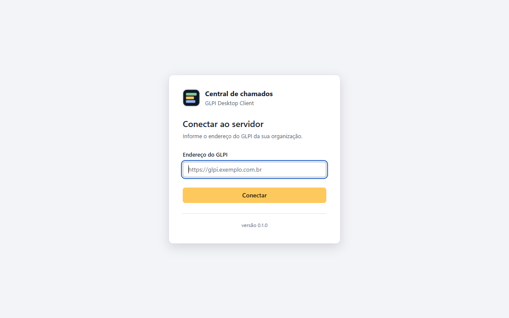

# Instalação nas estações

## Requisitos

- Windows 10 ou 11, 64 bits.
- Acesso de rede, por HTTPS, ao endereço do GLPI.
- O [plugin instalado e configurado](configuracao-plugin.md) no servidor (inclusive o cliente de API).

## O que o instalador faz

- Instala para todos os usuários em `C:\Program Files\GLPI Desktop Client` (precisa de administrador ou SYSTEM).
- Cria o atalho **GLPI Desktop Client** no Menu Iniciar.
- Faz o app iniciar com o Windows, na bandeja (`HKLM\Software\Microsoft\Windows\CurrentVersion\Run`).
- Aparece em "Aplicativos instalados" como **GLPI Desktop Client** com a versão.

O instalador **não tem assinatura digital**. Ao executar à mão, o Windows pode mostrar "O Windows
protegeu o computador" (SmartScreen): confira o SHA-256 e use **Mais informações → Executar assim
mesmo**. Na instalação silenciosa por ferramenta de distribuição, esse aviso não aparece.

## Instalação manual

1. Baixe `GLPI-Desktop-Client-Setup-x.y.z.exe` nas
   [Releases](https://github.com/Wantuilxavier/Glpi-desktop-releases/releases) e execute.
2. Na primeira abertura, sem nenhuma configuração da máquina, o app mostra **Conectar ao servidor**:
   o usuário informa o endereço do GLPI (com ou sem `https://`), e o app confere se o plugin está lá.

   

   - "Servidor encontrado": o app guarda o endereço para aquele usuário e abre a tela de entrada.
   - "Não encontrei o plugin neste servidor. Peça ao administrador para instalar o plugin."
   - "Não foi possível conectar. Verifique o endereço." (endereço errado, sem rede ou certificado inválido).
   - Endereço com `http://`: o app avisa que a conexão não é criptografada e só continua se o usuário confirmar.

## Instalação em massa

### Parâmetros do instalador

```bat
GLPI-Desktop-Client-Setup-0.3.0.exe /S /GLPI_URL=https://glpi.exemplo.com.br
```

| Parâmetro | O que faz |
|---|---|
| `/S` | instalação silenciosa, sem perguntas |
| `/GLPI_URL=<endereço>` | define o servidor do GLPI nesta máquina (o usuário não vê "Conectar ao servidor") |
| `/APP_TOKEN=<token>` | opcional: App-Token do cliente de API. Sem ele, o app recebe o do plugin depois do login |
| `/LOCK_SERVER=1` | opcional: o usuário não pode trocar de servidor (some a opção "Trocar servidor") |
| `/APP_NAME="<nome>"` | opcional (a partir da 0.2.0): nome que os usuários veem (ex.: "Suporte TI"). Veja [Nome do aplicativo](#nome-do-aplicativo). `/APP_NAME=""` apaga o nome |

Os valores vão para `HKLM\SOFTWARE\GlpiDesktopClient`. Uma atualização sem parâmetros mantém o que já
estava gravado. Se o valor tiver espaços, use aspas: `/GLPI_URL="https://glpi.exemplo.com.br"`.

O pacote `.msi` não aceita esses parâmetros: para configurar a máquina com ele, use a GPO ou o `config.json`.

### Nome do aplicativo

O administrador pode definir o nome que os usuários veem, para seguir a comunicação interna da
organização:

```bat
GLPI-Desktop-Client-Setup-0.3.0.exe /S /GLPI_URL=https://glpi.exemplo.com.br /APP_NAME="Central de Atendimento"
```

O nome vale para o título da janela, o cabeçalho, a tela de entrada e "Conectar ao servidor", e a
bandeja (dica e "Fechar o …").

**Regras:** de 2 a 40 caracteres, sem os caracteres `\ / : * ? " < > |` (o nome também vira nome de
atalho). Os espaços no início e no fim são ignorados. Com um nome inválido, o app usa o próximo nome
da ordem abaixo e registra o motivo no log.

**Ordem de prioridade:**

1. `appName` da máquina: GPO (`HKLM\SOFTWARE\Policies\GlpiDesktopClient`), instalador (`/APP_NAME=`)
   ou `config.json`, nessa ordem;
2. "Nome exibido no app" e "Título da janela" da aba **Identidade** do plugin;
3. o padrão: "Central de chamados" no cabeçalho e "GLPI Desktop Client" no título da janela.

Como o primeiro item é configuração da máquina, cada estação ou grupo de estações pode ter o seu
nome (por exemplo, uma GPO por OU). Sem `appName`, vale o que estiver no plugin para todo mundo.

**Atalho do Menu Iniciar:** o instalador renomeia o atalho para `<nome>.lnk`. Só o instalador pode
fazer isso, porque o atalho é de todos os usuários e o app roda sem permissão de administrador. Se o
nome mudar depois pela GPO ou pelo `config.json`, o app passa a mostrar o nome novo na próxima
abertura, mas o atalho continua com o nome anterior até o instalador rodar de novo com
`/APP_NAME=`. Se você fixa o atalho na barra de tarefas ou no Menu Iniciar por caminho (layout XML),
use o nome novo do `.lnk` no layout.

**O que não muda:** o nome em "Aplicativos instalados", o nome do executável
(`GLPI Desktop Client.exe`), a pasta de instalação (`C:\Program Files\GLPI Desktop Client`) e o
nome do programa nas notificações do Windows continuam os do pacote.

### GPO (Active Directory)

Numa GPO de **computador**, vinculada primeiro a uma OU de teste:

- **Instalação:** *Configuração do Computador → Políticas → Configurações do Windows → Scripts →
  Inicialização* → um `.cmd` com:

  ```bat
  if not exist "C:\Program Files\GLPI Desktop Client\GLPI Desktop Client.exe" ^
    "\\servidor\compartilhamento\GLPI-Desktop-Client-Setup-0.3.0.exe" /S /GLPI_URL=https://glpi.exemplo.com.br
  ```

  O compartilhamento precisa ser legível por "Computadores do domínio". O script roda como SYSTEM,
  antes do logon. Para atualizar, troque o arquivo e tire o `if not exist` (ou use o script
  PowerShell abaixo, que confere a versão).
- **Configuração sem parâmetros no instalador** (opcional): *Configuração do Computador → Preferências →
  Configurações do Windows → Registro* → **Atualizar** em `HKEY_LOCAL_MACHINE\SOFTWARE\Policies\GlpiDesktopClient`:

  | Valor | Tipo | Exemplo |
  |---|---|---|
  | `glpiUrl` | `REG_SZ` | `https://glpi.exemplo.com.br` |
  | `lockServer` | `REG_DWORD` | `1` (opcional) |
  | `appToken` | `REG_SZ` | opcional |
  | `dominiosSSO` | `REG_SZ` | opcional, ex.: `*.exemplo.com.br` |
  | `intervaloMinutos` | `REG_DWORD` | opcional, padrão `2` |
  | `appName` | `REG_SZ` | opcional, ex.: `Suporte TI` ([nome do aplicativo](#nome-do-aplicativo)) |

  A GPO vence o que o instalador gravou. Exemplo para dar um nome às estações de uma OU: uma GPO
  vinculada a essa OU com só o valor `appName`.

### Intune

Empacote o instalador como **aplicativo Win32** (`.intunewin`):

- Instalação: `GLPI-Desktop-Client-Setup-0.3.0.exe /S /GLPI_URL=https://glpi.exemplo.com.br`
- Desinstalação: `"C:\Program Files\GLPI Desktop Client\Uninstall GLPI Desktop Client.exe" /S`
- Contexto: sistema. Regra de detecção: arquivo `C:\Program Files\GLPI Desktop Client\GLPI Desktop Client.exe`.

### Script PowerShell (RMM, Intune, GPO)

[`deploy/powershell/Instalar-GlpiDesktopClient.ps1`](../deploy/powershell/Instalar-GlpiDesktopClient.ps1)
roda como SYSTEM. Ele:

- grava a configuração da máquina;
- baixa o instalador (http/https ou caminho de rede) e confere o SHA-256;
- fecha o app aberto, instala com `/S` e confere a versão instalada.

Se a versão pedida já estiver instalada, só regrava a configuração. Ele sai com 0 quando dá certo e
com 1 quando falha.

```powershell
.\Instalar-GlpiDesktopClient.ps1 `
  -UrlInstalador "https://github.com/Wantuilxavier/Glpi-desktop-releases/releases/download/v0.3.0/GLPI-Desktop-Client-Setup-0.3.0.exe" `
  -Versao "0.3.0" `
  -Sha256 "<SHA-256 do SHA256SUMS.txt>" `
  -GlpiUrl "https://glpi.exemplo.com.br" `
  -LockServer
```

`-AppToken`, `-DominiosSSO`, `-IntervaloMinutos` e `-AppName` (a partir da 0.2.0; ex.:
`-AppName "Central de Atendimento"`) são opcionais. Com `-AppName`, o nome vai para o `config.json` e
para o instalador (`/APP_NAME=`), que renomeia o atalho; se a versão pedida já estiver instalada, só o
`config.json` muda. Para remover:
[`deploy/powershell/Desinstalar-GlpiDesktopClient.ps1`](../deploy/powershell/Desinstalar-GlpiDesktopClient.ps1)
(`-ApagarConfig` apaga também `C:\ProgramData\GlpiDesktopClient`).

### Arquivo de configuração

Alternativa ao registro: `%ProgramData%\GlpiDesktopClient\config.json` (ou seja,
`C:\ProgramData\GlpiDesktopClient\config.json`), criado pela GPO, Intune ou script:

```json
{
  "glpiUrl": "https://glpi.exemplo.com.br",
  "appToken": "",
  "dominiosSSO": "",
  "intervaloMinutos": 2,
  "lockServer": false,
  "appName": ""
}
```

`appName` vazio = sem nome próprio (vale o do plugin ou o padrão).

Ordem em que o app procura (a primeira que tiver o valor vence): GPO
(`HKLM\SOFTWARE\Policies\GlpiDesktopClient`), instalador (`HKLM\SOFTWARE\GlpiDesktopClient`),
`config.json`. Sem `lockServer`, o servidor que o usuário escolher em "Trocar servidor" vale para
ele no lugar do da máquina.

## Atualização

Rode o instalador novo da mesma forma, por cima do anterior. Feche o app antes
(`taskkill /im "GLPI Desktop Client.exe" /f`); o script PowerShell já faz isso. A configuração
da máquina e os dados dos usuários são mantidos. App e plugin vêm juntos em cada release: atualize o
plugin no servidor junto.

## Desinstalação

- Manual: *Configurações do Windows → Aplicativos instalados → GLPI Desktop Client → Desinstalar*.
- Silenciosa: `"C:\Program Files\GLPI Desktop Client\Uninstall GLPI Desktop Client.exe" /S`.

A desinstalação remove o programa, o início automático e a configuração gravada pelo instalador. A
GPO, o `config.json` e os dados de cada usuário (`%APPDATA%\GLPI Desktop Client`) ficam.

## Conferir numa estação

- "Aplicativos instalados" mostra **GLPI Desktop Client** e a versão.
- `reg query HKLM\SOFTWARE\GlpiDesktopClient` e `reg query HKLM\SOFTWARE\Policies\GlpiDesktopClient`.
- Log do app (por usuário): `%APPDATA%\GLPI Desktop Client\logs\glpi-desktop-client.log`.
