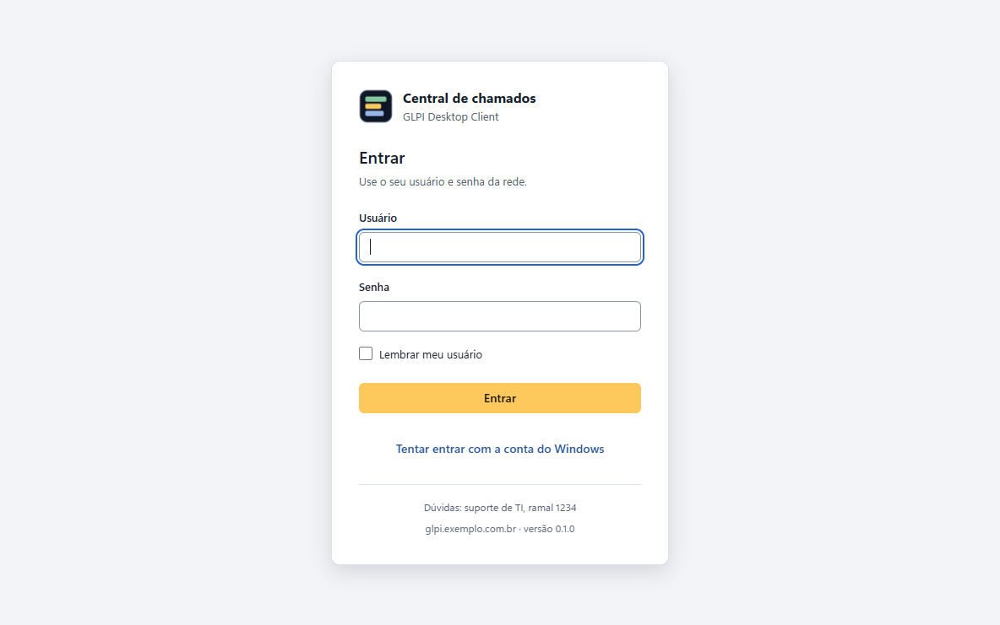

# Primeiro acesso

## Conectar ao servidor

Se o administrador já definiu o servidor na instalação, esta tela não aparece. Senão, o app pede o
endereço do GLPI (por exemplo `glpi.exemplo.com.br`) e confere se o plugin está instalado. Veja as
mensagens em [Instalação nas estações](instalacao-estacoes.md#instalação-manual).

## Entrar

- **Com a conta do Windows:** com a opção ativada no plugin, o app entra sozinho ao abrir
  ("Entrando com a sua conta do Windows…").
- **Com usuário e senha:** a tela aparece quando a conta do Windows não funciona ou está desativada.
  O usuário pode ser digitado como `usuario`, `EXEMPLO\usuario` ou `usuario@exemplo.com.br`.
  "Lembrar meu usuário" guarda só o nome de usuário. Depois de 5 senhas erradas seguidas, o app espera
  30 segundos antes de aceitar outra tentativa.

  

- Se a sessão expirar no meio do uso, o app tenta a conta do Windows sozinho; se não der, a tela de
  login abre por cima, sem perder o que está aberto, e a ação é repetida depois de entrar.

## Usar

- **Meus chamados:** "Abertos por mim" e, para perfis técnicos, "Atribuídos a mim" e "Dos meus grupos",
  com o filtro "Só em aberto". Os filtros voltam ao padrão quando o app reabre.
- **Abrir um chamado:** aba **Novo chamado**, com os formulários do GLPI que o usuário pode responder.
  O rascunho é salvo sozinho até o envio, e dá para anexar arquivos ou uma captura de tela.
- **Responder:** no chamado aberto, com anexos. Quem tem permissão no perfil altera os campos e os
  atores na lateral.
- **Novidades:** notificação do Windows e número no ícone da barra de tarefas e da bandeja.
- **Tema:** na engrenagem (canto superior direito) — seguir o Windows, claro ou escuro, com ou sem as
  cores do GLPI.

## Sair e trocar de servidor

- **Sair** (engrenagem ou menu da bandeja): encerra a sessão neste computador e apaga o que é do
  usuário. O app continua na bandeja e não entra sozinho até o usuário pedir. **Fechar o GLPI Desktop
  Client**, no menu da bandeja, encerra o app.
- **Trocar servidor** (engrenagem): sai da sessão, esquece o servidor escolhido e volta para "Conectar
  ao servidor". Não aparece quando o administrador travou o servidor (`lockServer`).
